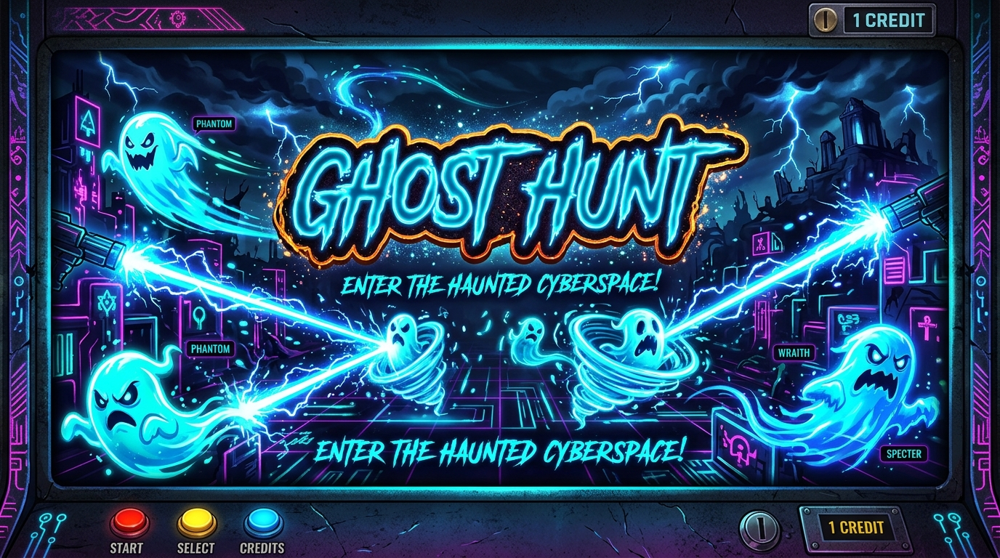

<div align="center">

# 👻 GHOST HUNT

### *Interactive Vector Ghost-Hunting Web Game*

[](https://developer.mozilla.org/en-US/docs/Web/HTML)
[](https://developer.mozilla.org/en-US/docs/Web/JavaScript)
[](http://snapsvg.io/)
[](https://rxjs.dev/)
[](LICENSE)

<br/>



<p align="center">
  <strong>Maneuver your containment emitter, fire electric proton lightning streams, and capture wandering vector ghosts!</strong>
</p>

[🕹️ Play Game](#-quick-start) • [✨ Features](#-features) • [🎮 Controls](#-controls--gameplay) • [🏗️ Architecture](#️-tech-stack--architecture) • [🚀 Deploy](#-deploying-to-github-pages)

</div>

---

## 🌟 Overview

**Ghost Hunt** is a fast-paced, physics-driven interactive browser arcade game inspired by classic ghostbusting mechanics. Built using procedural SVG graphics, reactive streams with **RxJS**, and vector animations via **Snap.svg**, it delivers smooth 60 FPS gameplay directly in your browser with zero build steps or heavy dependencies.

Navigate your containment emitter along the bottom of the screen, aim and hold to fire a dynamic electric proton beam, and lock onto mischievous ghosts to neutralize and capture them!

---

## ✨ Features

- ⚡ **Dynamic Proton Stream**: Procedural bezier curve lightning stream with randomized electric arc discharge and neon blur glow filters.
- 👻 **Procedural Vector Ghosts**: Dynamic floating ghosts that drift smoothly across the stage and react with shocked facial expressions when struck by the proton beam.
- 🎯 **Reactive Stream Controls**: Built with **RxJS** observables for frictionless event handling, combining mouse, touch, and keyboard interactions into unified reactive pipelines.
- 🔊 **Built-in Web Audio Synthesizer**: Pure Web Audio API procedural sound engine generating retro proton beam hums and electric shock zap sound effects—no audio asset downloads required.
- 🪟 **Glassmorphic Cyber HUD**: High-contrast, neon cybernetic interface displaying active ghost counts, captured statistics, live status indicators, and sound toggles.
- 📱 **Fully Responsive & Cross-Platform**: Adapts seamlessly to any screen size with support for both desktop keyboard/mouse and mobile touch inputs.
- 🚀 **Zero Build Setup**: Pure HTML5, Vanilla CSS, and JavaScript. Clone and run instantly!

---

## 🎮 Controls & Gameplay

| Action | Desktop Controls | Mobile / Touch | Description |
| :--- | :--- | :--- | :--- |
| **Move Emitter** | <kbd>A</kbd> / <kbd>D</kbd> or <kbd>←</kbd> / <kbd>→</kbd> | Keyboard / Onscreen | Glides the containment emitter horizontally with inertia |
| **Fire Proton Beam** | **Left Click & Hold** + Move Mouse | **Touch & Hold** + Drag Finger | Generates and aims the high-energy electric proton stream |
| **Capture Ghost** | Aim stream at ghost | Aim stream at ghost | Locks the beam onto the ghost, stunning it with electrical bolts |
| **Add Ghost** | Click **➕** in HUD | Tap **➕** in HUD | Spawns additional ghosts dynamically into the haunted space |
| **Toggle Sound** | Click **🔊 / 🔇** in HUD | Tap **🔊 / 🔇** in HUD | Mutes or enables real-time synthesized audio |

---

## 🚀 Quick Start

### 1. Clone the Repository
```bash
git clone https://github.com/pabitralenka07/Ghost_game.git
cd Ghost_game
```

### 2. Run Locally

#### Option A: Direct Open
Simply double-click [`index.html`](index.html) or open it directly in any modern web browser (Chrome, Firefox, Safari, Edge).

#### Option B: Local HTTP Server (Recommended)
Using Python 3:
```bash
python3 -m http.server 8000
```
Or using Node.js:
```bash
npx serve .
```
Then visit **`http://localhost:8000`** in your browser.

---

## 🌐 Deploying to GitHub Pages

You can host this game for free in just a few clicks with GitHub Pages:

1. Go to your repository on GitHub: `https://github.com/pabitralenka07/Ghost_game`
2. Navigate to **Settings** > **Pages** (in the left sidebar).
3. Under **Branch**, select `main` and folder `/ (root)`.
4. Click **Save**.
5. Your live game URL will be ready at:
   ```
   https://pabitralenka07.github.io/Ghost_game/
   ```

---

## 🏗️ Tech Stack & Architecture

- **[Snap.svg](http://snapsvg.io/)**: Hardware-accelerated SVG manipulation, dynamic path updates, SVG filters (Gaussian blur for neon glows), and vector groups.
- **[RxJS 5](https://rxjs.dev/)**: Reactive Extensions for JavaScript handling complex event streams (`keydown`, `keyup`, `mousedown`, `mousemove`, `touchstart`, `touchmove`).
- **[Web Audio API](https://developer.mozilla.org/en-US/docs/Web/API/Web_Audio_API)**: Real-time audio synthesis generating dynamic sawtooth beam oscillations, low-pass filtering, and square-wave capture arcs.
- **HTML5 & CSS3**: Custom dark neon cyber aesthetic with CSS glassmorphism (`backdrop-filter`) and Catamaran / Orbitron typography.

---

## 📂 Project Structure

```text
Ghost_game/
├── assets/
│   └── banner.jpg          # High-resolution project showcase banner
├── index.html              # Primary entry point with modern HUD & audio synthesis
├── ghost-hunt ..html       # Original standalone game prototype
├── .gitignore              # Standard git exclusion rules
├── LICENSE                 # MIT Open Source License
└── README.md               # Project documentation and guide
```

---

## ⚙️ Customization & Game Tuning

You can easily customize game variables inside `index.html`:

```javascript
// Adjust player movement velocity
this.PLAYER_SPEED = 14;

// Adjust ghost body dimensions and count
this.width = 44 + random;
this.height = 60 + random;

// Customize electric bolt intensity
this.boltCount = 22;
this.boltPointSpace = 10;
```

---

## 🤝 Contributing

Contributions, issues, and feature requests are welcome!
Feel free to check the [issues page](https://github.com/pabitralenka07/Ghost_game/issues).

1. Fork the Project (`gh repo fork pabitralenka07/Ghost_game`)
2. Create your Feature Branch (`git checkout -b feature/AmazingFeature`)
3. Commit your Changes (`git commit -m 'Add some AmazingFeature'`)
4. Push to the Branch (`git push origin feature/AmazingFeature`)
5. Open a Pull Request

---

## 📜 License

Distributed under the **MIT License**. See [`LICENSE`](LICENSE) for more information.

---

<div align="center">
  <sub>Built with ⚡ and 👻 by <a href="https://github.com/pabitralenka07">Pabitra Lenka</a></sub>
</div>
